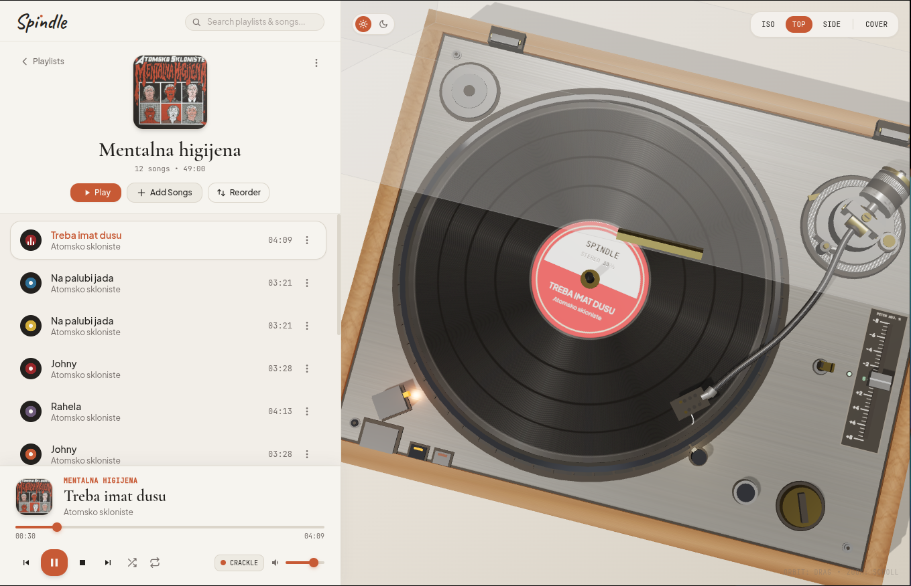

# 🎵 Spindle

<div align="center">
  <p><strong>A tactile, analog-inspired desktop vinyl record player and offline music manager.</strong></p>
  
  <br>

  

  <br><br>

  <p>
    <a href="https://github.com/karumataken/spindle/releases"><strong>Download Releases</strong></a> •
    <a href="#about-the-project">About</a> •
    <a href="#features">Features</a> •
    <a href="#running-from-source">Run from Source</a>
  </p>
</div>

---

### 📦 Downloads

Pre-built releases for **Linux** (`.AppImage`, `.deb`, `.rpm`) and **Windows** (`.exe`) are available directly on the [**Releases Page**](https://github.com/karumataken/spindle/releases).

---

### 💡 About the Project

> [!NOTE]
> **Spindle** is an experimental hobby project **vibe-coded with Gemini**. Any feedback, suggestions, issues, or ideas are warmly welcome! Feel free to open an issue or start a discussion.

---

### ✨ Features

- **Interactive 3D Turntable:** Real-time WebGL/Three.js vinyl simulation with spinning records, tonearm tracking, and mechanical needle drops.
- **Offline Music Library:** Drag & drop local audio files (`.mp3`, `.wav`, `.ogg`, `.flac`, `.m4a`) or organize into custom playlists stored locally.
- **YouTube & YouTube Music Import:** Paste a link to stream/download tracks or entire albums directly into playlists with authentic artwork.
- **Procedural Vinyl Records:** Distinct procedural vinyl discs, center labels, and color palettes that pair with every track.
- **Analog Aesthetic:** Warm editorial typography and retro design built for a distraction-free listening experience.

---

### 🚀 Running from Source

#### Prerequisites
- **Node.js** (v18+)
- **yt-dlp** & **ffmpeg** (for audio downloading):
  - *Fedora:* `sudo dnf install ffmpeg yt-dlp`
  - *Ubuntu / Debian:* `sudo apt install ffmpeg yt-dlp`
  - *macOS:* `brew install ffmpeg yt-dlp`
  - *Windows:* `winget install yt-dlp ffmpeg`

#### Setup
```bash
git clone https://github.com/karumataken/spindle.git
cd spindle
npm install
npm run dev:desktop
```

---

### 📄 License

[ISC](LICENSE)
